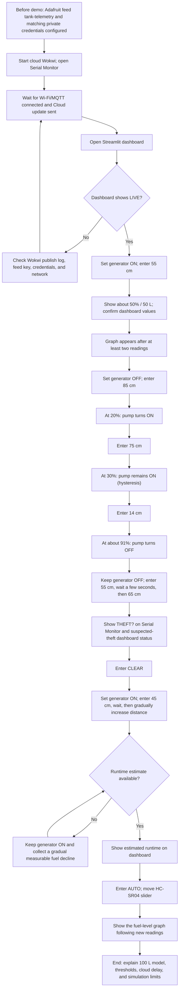

# Demonstration flowchart

Use this as the simple presenter/evaluator sequence. It assumes the cloud-enabled Wokwi version and the dashboard are configured first.

## Editable Mermaid version

### Presenter reminders

- Calibration: 5 cm = full; 105 cm = empty. Distance input remains manual until `AUTO`.
- Dashboard values are arranged beside the graph on desktop and stacked on mobile.
- Click `↻` to request a dashboard refresh; it also refreshes automatically.
- Runtime needs generator-ON history with a measurable fuel decline. It will show `—` until the firmware has enough data.
- If freshness reads **STALE**, resolve telemetry connectivity before presenting cloud results.
- This is a simulation. The theft alarm means suspected rapid loss, not confirmed theft; the relay and buzzer must not control real fuel equipment.
