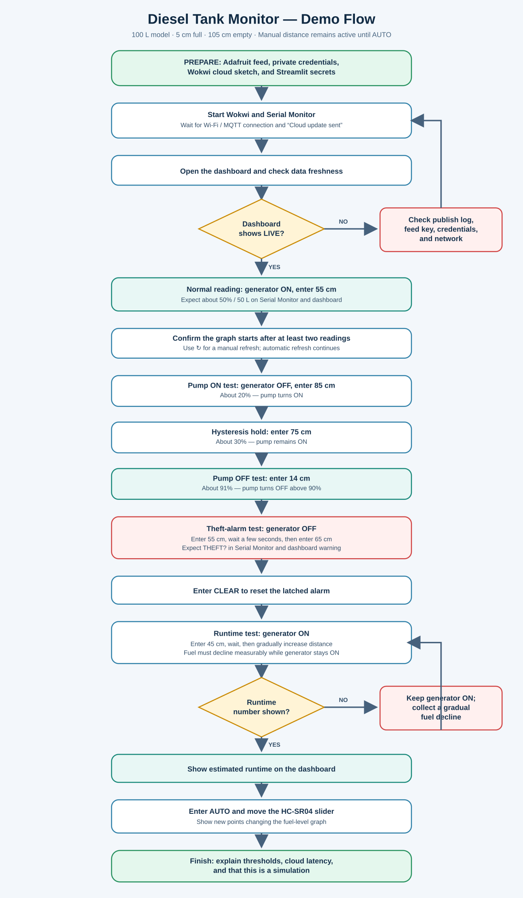
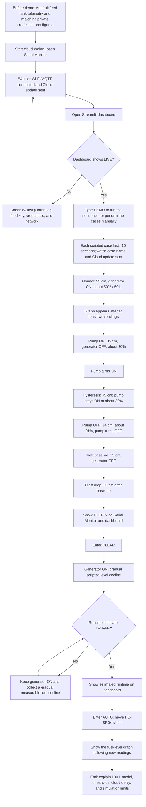

# Demonstration flowchart

Use this as the simple presenter/evaluator sequence. It assumes the cloud-enabled Wokwi version and dashboard are configured first. You can perform the steps manually, or type `DEMO` in Wokwi Serial Monitor to run them automatically. The scripted sequence holds each case for 10 seconds and publishes multiple readings for the dashboard; it cannot confirm that a browser has finished rendering a case.

## Editable Mermaid version

### Presenter reminders

- Calibration: 5 cm = full; 105 cm = empty. Distance input remains manual until `AUTO`.
- To run the scripted cloud demo, type `DEMO` in Serial Monitor. It takes about 140 seconds, with a 10-second display window per case.
- Enter a distance to interrupt the script and resume manual input; enter `AUTO` or `STOP` to cancel and resume the ultrasonic slider.
- Dashboard values are arranged beside the graph on desktop and stacked on mobile.
- Click `↻` to request a dashboard refresh; it also refreshes automatically.
- Runtime needs at least 60 seconds of generator-ON history with a measurable fuel decline. It will show `—` until the firmware has enough data; the scripted runtime segment is about 70 seconds.
- The sketch holds a case for 10 seconds but does not know whether the browser has rendered it. Confirm the cloud update log and **LIVE** freshness on the dashboard.
- If freshness reads **STALE**, resolve telemetry connectivity before presenting cloud results.
- This is a simulation. The theft alarm means suspected rapid loss, not confirmed theft; the relay and buzzer must not control real fuel equipment.
