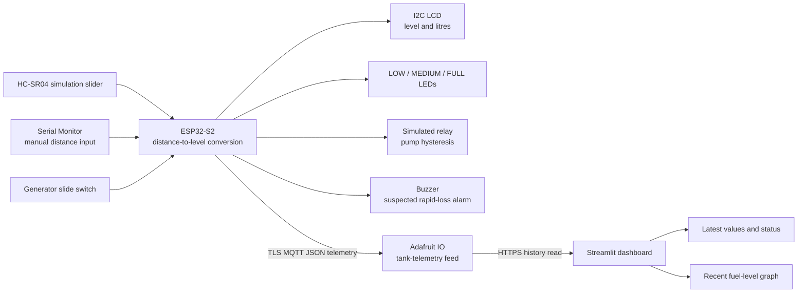

# Diesel Tank Level and Theft Monitor

**A Wokwi ESP32-S2 simulation with live tank monitoring, refill hysteresis, and rapid-loss alerting**

**Team:** [Add names]

**Department / Institution:** [Add department and institution]

**Course / Guide:** [Add course and guide, if required]

## 1. Introduction

Fuel stored in a generator tank needs regular monitoring so that operators can identify low fuel, understand consumption, and investigate unexpected losses. This project demonstrates a simulated diesel tank monitor using an ESP32-S2 and an HC-SR04 ultrasonic sensor. The system converts distance to tank level and litres, displays status locally, controls a simulated refill relay with hysteresis, and publishes telemetry to a web dashboard.

## 2. Problem statement

Manual inspection does not provide continuous visibility of tank level. A monitoring system should show the remaining fuel, indicate when refilling is needed, estimate generator runtime when consumption data is available, and flag a rapid unexplained level decrease when the generator is switched OFF.

## 3. Objectives

- Convert ultrasonic distance into fuel level percentage and litres for a 100 L model tank.
- Show fuel level and litres on the LCD and indicate LOW, MEDIUM, or FULL status with LEDs.
- Demonstrate pump hysteresis: pump ON at or below 20%; pump OFF only above 90%.
- Provide a generator ON/OFF slide switch for the simulation.
- Flag a decrease greater than 5 percentage points within 60 seconds while the generator is OFF.
- Display current telemetry and the recent fuel-level graph in a responsive dashboard.
- Demonstrate manual distance entry and the HC-SR04 distance control in Wokwi.

## 4. System design

### System block diagram



### Main components

| Component | Purpose |
|---|---|
| ESP32-S2 (Wokwi) | Reads simulated inputs, calculates tank state, drives simulated outputs, and publishes telemetry |
| HC-SR04 (Wokwi) | Supplies a simulated distance measurement using its adjustable distance control |
| Serial Monitor | Accepts a manual distance from 0 to 105 cm; `AUTO` returns input to the sensor |
| I2C LCD | Displays level and remaining litres |
| LEDs | Show LOW / MEDIUM / FULL bands |
| Relay and buzzer | Simulate pump control and suspected theft alert |
| Generator slide switch | Selects generator ON or OFF state |
| Adafruit IO and Streamlit | Carry telemetry to the cloud and display values and history |

## 5. Working principle

The model uses a tank capacity of **100 L**, with **5 cm as full** and **105 cm as empty**. For in-range readings, the level fraction is calculated as:

```text
level (%) = (105 - measured distance in cm) / (105 - 5) × 100
litres    = level fraction × 100 L
```

The result is clamped between 0% and 100%. For example, 55 cm represents approximately 50% or 50 L.

Pump control uses hysteresis to avoid switching repeatedly near one threshold. It turns ON at or below 20% and stays ON until the level rises above 90%. When the generator is OFF, a drop greater than 5 percentage points within a 60-second window raises the **suspected theft** alarm. This is a rule-based warning for the simulation, not proof of theft.

The runtime estimate is based on observed fuel decline while the generator is ON. It is unavailable until sufficient change over time has been observed; one reading alone cannot produce a consumption rate.

## 6. Poster results table

The following are expected demonstration values calculated from the tank calibration. Replace or supplement this table with values and screenshots captured during the final run.

| Distance | Approximate level | Approximate fuel | Expected behavior |
|---:|---:|---:|---|
| 5 cm | 100% | 100 L | Full tank; pump OFF |
| 55 cm | 50% | 50 L | Mid-level; pump state remains hysteresis-dependent |
| 85 cm | 20% | 20 L | Pump turns ON at the low threshold |
| 75 cm after pump is ON | 30% | 30 L | Pump remains ON; it has not risen above 90% |
| 14 cm | 91% | 91 L | Pump turns OFF because level is above 90% |
| Rapid drop while generator is OFF | Drop >5 percentage points in 60 sec | Depends on starting level | Suspected theft alarm and buzzer activate |

## 7. Demonstration sequence

1. Start the Wokwi simulation and open the Serial Monitor. Confirm the cloud-enabled version reports Wi-Fi/MQTT connection and `Cloud update sent`.
2. Open the dashboard and wait for a **LIVE** reading. The graph needs at least two readings to draw a line.
3. Enter `55` cm. Show approximately **50% / 50 L** on the LCD, Serial Monitor, and dashboard.
4. Enter `85` cm. Show the pump turning ON at 20%.
5. Enter `75` cm. Show that the pump stays ON due to hysteresis.
6. Enter `14` cm. Show the pump turning OFF above 90%.
7. Switch the generator OFF. Enter `55`, wait a few seconds, then enter `65`. Show the rapid-loss alert and the dashboard status.
8. Enter `CLEAR` to reset the latched theft alarm.
9. Switch the generator ON and demonstrate a gradual fuel decrease over time. Show the runtime estimate only once enough consumption history is available.
10. Use `AUTO` to return to the ultrasonic slider. Show that later distance changes continue updating the graph.

## 8. Expected display output

For a 55 cm manual reading, the Serial Monitor output should be similar to:

```text
Input mode: MANUAL
Distance: 55.0 cm
Fuel level: 50.0 %
Fuel remaining: 50.0 L / 100 L
Generator: ON
Refill pump / relay: OFF
Theft alarm: OFF
Estimated runtime: collecting generator fuel-use history
Cloud update sent: {"timestamp":...,"distance_cm":55.00,"level_percent":50.00,...}
```

The exact output lines and runtime value depend on the current switch state, history, and cloud connection.

The dashboard presents fuel remaining, tank level, generator state, refill pump state, estimated runtime, and data freshness beside a recent fuel-level graph. On mobile, the values and graph stack vertically. A **STALE** status means the dashboard is displaying the last received values, not current telemetry.

## 9. Images to place on the poster

Use the supplied screenshots in `assets/`:

- **System implementation:** `assets/wokwi-circuit-and-code.png`
- **Dashboard with graph:** `assets/dashboard-with-graph.png`
- **Larger graph panel:** `assets/fuel-level-graph.png`
- **Layout reference only:** `assets/reference-image.jpg`

The supplied dashboard/graph screenshot shows stale data and old-capacity feed history. Label it as a UI illustration or replace it with a new screenshot from a verified **LIVE** run before calling it a final result.

## 10. Conclusion

The simulation demonstrates how an ESP32-based monitor can convert distance measurements into fuel level and volume, apply refill-pump hysteresis, monitor generator state, identify rapid unexplained drops, and present telemetry on a dashboard with a history graph. The cloud link depends on network and hosting availability, and the runtime estimate requires observed consumption history.

## 11. Limitations and future work

- Wokwi is a simulation; the relay, buzzer, sensor, and tank are not connected to real fuel equipment.
- A sudden level change can be caused by sensor noise or simulation input, so the alarm means **suspected** theft, not confirmed theft.
- Runtime estimates depend on enough valid generator-ON readings and may vary with changing generator load.
- Cloud and dashboard update timing depends on the network and hosting platform.
- Future improvements could include testing with calibrated hardware, sensor-noise filtering, persistent data storage, and validation of alarms against real operating data.
